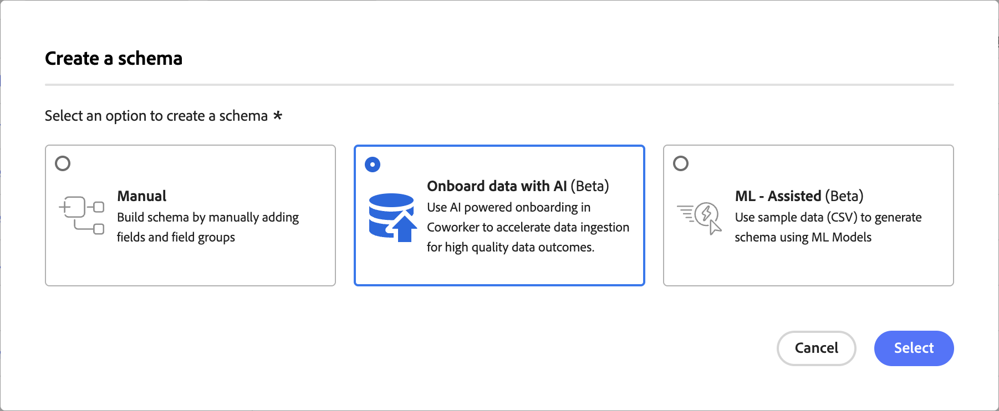

# Incorporación de datos con Coworker

>[!AVAILABILITY]
>
>La aptitud para la incorporación de datos está en versión beta. La documentación y las funcionalidades están sujetas a cambios.
>
>La aptitud para la incorporación de datos está disponible para los clientes con acceso a Adobe CX Enterprise Coworker, donde también debe estar habilitada para su organización. <!-- VERIFY BEFORE PUBLISH: confirm exact permission/entitlement name with Umesh Gohil, PLAT-296546. -->

Utilice la habilidad de incorporación de datos en CX Coworker para incorporar nuevos datos en Adobe Experience Platform a través de un único flujo de trabajo conversacional. En lugar de navegar por varias pantallas para conectar una fuente y crear un esquema a mano, describa la intención y el colaborador le guiará a través de la selección de la fuente, la calidad de los datos, el enriquecimiento semántico, la asignación de esquemas, la creación de esquemas y la creación de flujos de datos.

<!-- VERIFY BEFORE PUBLISH: confirm the loaded skill name ("Onboard Data to Experience Platform") and the exact post-landing prompt/flow with Umesh Gohil once flag access is arranged. -->

## Requisitos previos {#prerequisites}

Antes de empezar, asegúrese de que dispone de lo siguiente:

- Acceso a Adobe Experience Platform y a la organización y zona protegida adecuadas.
- Acceso a Adobe CX Enterprise Coworker, con la aptitud de incorporación de datos habilitada para su organización.
- Permiso para crear esquemas en Adobe Experience Platform.

Para obtener instrucciones sobre la instalación de complementos, consulte la [guía de la interfaz de usuario de Coworker](https://experienceleague.adobe.com/en/docs/coworker/content/chat/ui-guide).

## Uso de la habilidad de incorporación de datos {#use-the-data-onboarding-skill}

Hoy, la aptitud para la incorporación de datos comienza con la creación de esquemas en la interfaz de usuario de Experience Platform, que abre el asistente con la intención ya rellenada.

Para utilizar la habilidad de incorporación de datos:

1. En Adobe Experience Platform, vaya a **[!UICONTROL Esquemas]** y, a continuación, seleccione **[!UICONTROL Crear esquema]**.
1. En el cuadro de diálogo **[!UICONTROL Crear un esquema]**, seleccione **[!UICONTROL Incorporar datos con IA]** y después seleccione **[!UICONTROL Seleccionar]**.

   

1. CX Coworker se abre en una nueva pestaña del explorador con una solicitud previamente rellenada desde la intención de creación del esquema, por lo que no es necesario reafirmarla.
1. Elija un origen para incorporar cuando se le solicite, por ejemplo [!DNL Amazon S3], [!DNL Data Landing Zone], [!DNL Delta Share] o [!DNL Marketo].

   <!-- VERIFY BEFORE PUBLISH: screenshot of the Coworker landing/session-start state does not exist yet anywhere. Capture once flag access is confirmed. -->

1. Continúe la conversación con su compañero a través de la revisión de la calidad de los datos, el enriquecimiento semántico, la asignación de esquemas y la creación de esquemas, confirmando cada paso a medida que avanza.

Para obtener más información sobre el uso de CX Coworker, consulte la [Guía de la interfaz de usuario de Coworker](https://experienceleague.adobe.com/en/docs/coworker/content/chat/ui-guide).

## Casos de uso admitidos {#supported-use-cases}

Explore las partes del flujo de trabajo de incorporación que la Habilidad de incorporación de datos le ayuda a completar.

### Seleccionar y conectar un origen

En lugar de localizar y configurar manualmente un conector de origen, describa los datos que desea introducir y deje que el Compañero de trabajo le ayude a identificar el origen correcto.

### Revisar calidad de datos

El compañero muestra señales de calidad de datos para el origen seleccionado antes de comprometerse con un esquema, de modo que puede detectar problemas más temprano en el proceso.

### Enriquecimiento semántico de datos

El compañero sugiere un significado semántico para los campos entrantes, lo que reduce el trabajo manual de asignación de campos sin procesar a definiciones estándar.

### Asignación y creación de un esquema

El compañero asigna los campos revisados a un esquema nuevo o existente y lo crea directamente en Adobe Experience Platform como parte de la misma conversación.

### Creación de un flujo de datos

El compañero completa la incorporación creando el flujo de datos necesario para incorporar los datos de forma continua.

## Próximos pasos {#next-steps}

Después de leer esta guía, debe comprender cómo iniciar la habilidad de incorporación de datos desde la creación del esquema y lo que le ayuda a lograr en CX Coworker.

Para el procedimiento de la interfaz de usuario de Experience Platform y los escenarios de acceso/elegibilidad, consulte [Incorporar datos con IA](https://experienceleague.adobe.com/en/docs/experience-platform/xdm/ui/resources/schemas#data-onboarding-skill) en la guía de la interfaz de usuario de esquemas.
