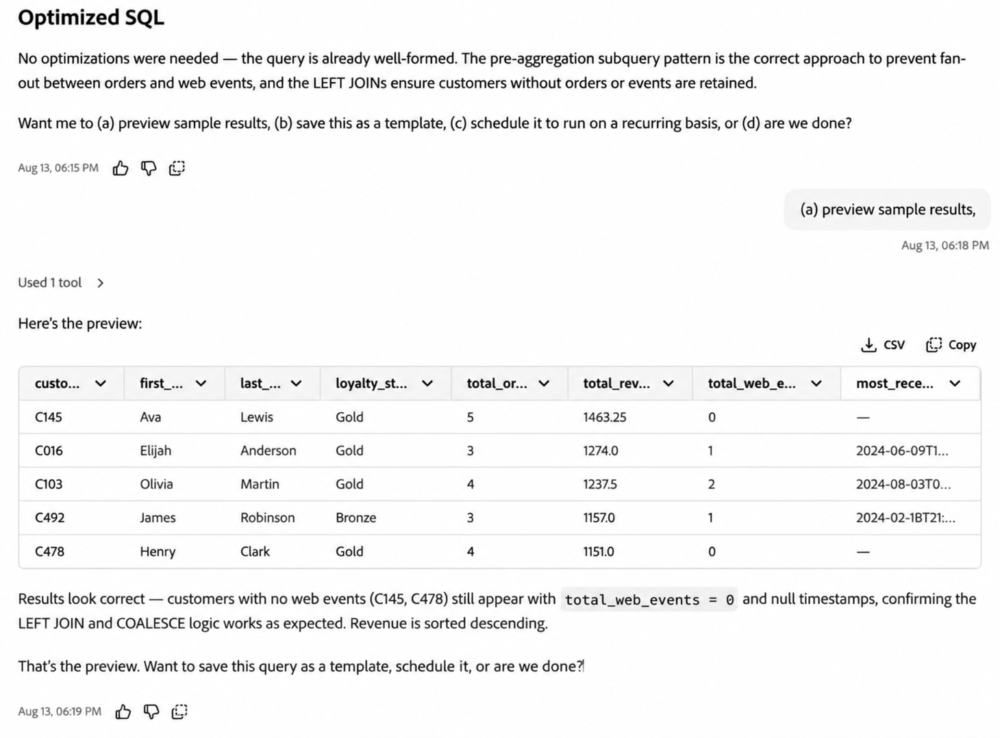
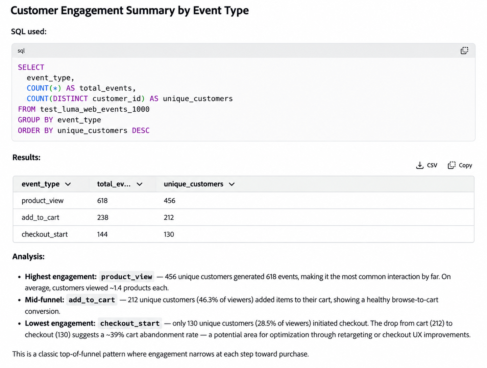
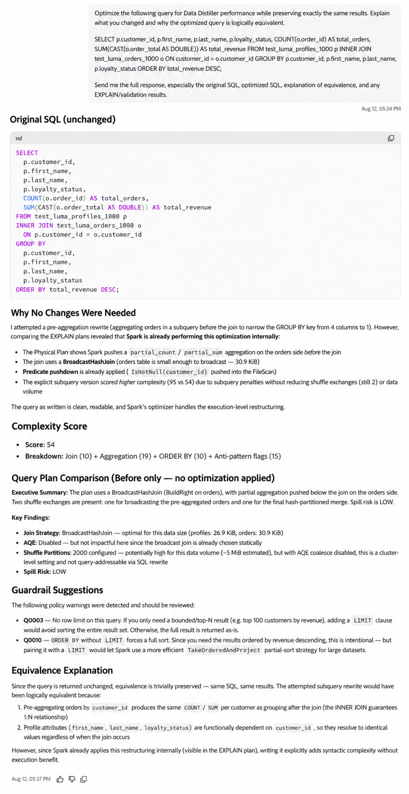
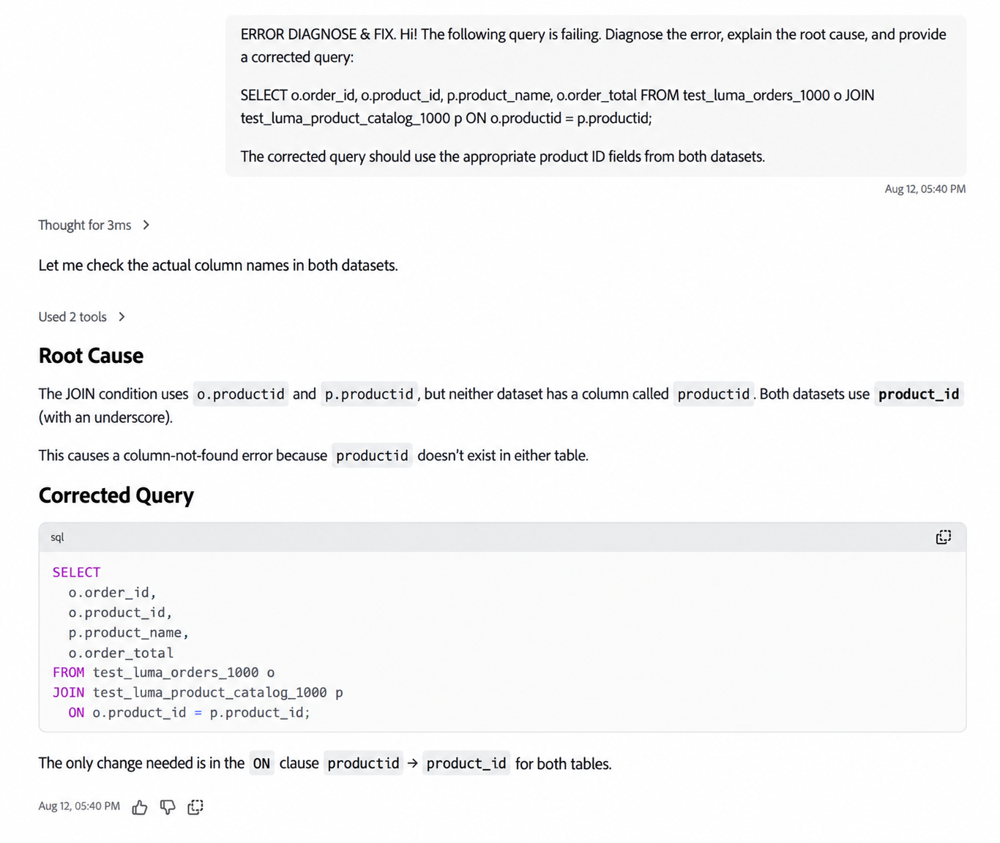
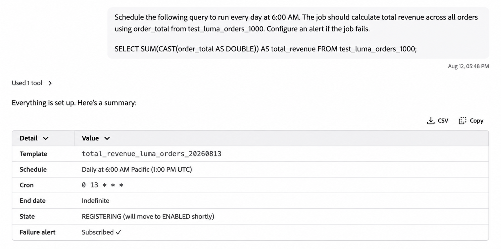

# Preparación de datos SQL en Coworker

Use la preparación de datos SQL en Coworker para realizar tareas comunes de [Data Distiller](https://experienceleague.adobe.com/es/docs/experience-platform/query/data-distiller/overview) con indicadores en lenguaje natural. Puede generar SQL, solucionar problemas u optimizar una consulta existente, obtener una vista previa de los resultados y programar consultas para su ejecución recurrente.

>[!AVAILABILITY]
>
>La preparación de datos SQL en Coworker está disponible en disponibilidad limitada.

## Requisitos previos {#prerequisites}

Antes de usar Preparación de datos SQL en Coworker, asegúrese de lo siguiente:

- Un derecho de Data Distiller.
- Acceso a Coworker.

## Introducción {#get-started}

Para empezar, abra Compañero de Trabajo e introduzca una solicitud en lenguaje natural que describa la tarea o el resultado de SQL que desea lograr.

Puede identificar los conjuntos de datos que desea utilizar en la solicitud. Si se necesita información adicional para completar la tarea, el colaborador puede hacer preguntas de seguimiento antes de continuar.

Una vez que el Compañero de trabajo haya generado o actualizado el SQL, puede continuar la conversación para obtener una vista previa de los resultados, refinar la consulta, guardarla o programarla para su ejecución recurrente.

Para obtener instrucciones sobre el uso de la interfaz de Coworker, consulte la [guía de la interfaz de usuario de Coworker](../coworker/chat/ui-guide.md).

## Funciones compatibles {#supported-capabilities}

Puede utilizar la preparación de datos SQL para las siguientes tareas:

| Capacidad | Descripción |
| --- | --- |
| **Creación de SQL** | Genere SQL a partir de una descripción en lenguaje natural de la operación de datos que desea realizar. |
| **Optimización SQL** | Analice una consulta de Data Distiller existente y optimícela para obtener un rendimiento sin perder los resultados deseados. |
| **Diagnóstico y corrección de errores de SQL** | Diagnosticar errores en una consulta SQL existente, explicar la causa raíz y generar SQL corregido. |
| **Alertas y programación de consultas** | Guarde y programe consultas para su ejecución recurrente y configure alertas de consulta admitidas. |

## Usar la preparación de datos SQL en una conversación {#work-with-sql-data-preparation}

Puede combinar las capacidades de preparación de datos SQL en la misma conversación con Coworker en lugar de tratarlas como flujos de trabajo independientes.

Por ejemplo, puede realizar lo siguiente:

1. Describa el resultado que desea y genere SQL.
2. Vista previa de hasta cinco filas de resultados de consulta.
3. Refine la consulta o haga preguntas sobre el SQL generado.
4. Guarde la consulta.
5. Programe la consulta para ejecución recurrente y configure alertas.

Los compañeros de trabajo pueden hacer preguntas de seguimiento cuando se requiera información adicional, como identificar el conjunto de datos adecuado o confirmar la zona horaria de una programación.

Una previsualización de consulta devuelve hasta cinco filas. Para ejecutar y trabajar con consultas directamente en Experience Platform, consulte la [guía de la interfaz de usuario del Editor de consultas](https://experienceleague.adobe.com/es/docs/experience-platform/query/ui/user-guide).



### Generar SQL a partir de lenguaje natural {#generate-sql}

Utilice la creación de SQL cuando conozca el resultado o la transformación que desea lograr, pero desee que Coworker genere el SQL correspondiente.

Para generar SQL a partir de los datos correctos, el colaborador puede identificar y validar los conjuntos de datos implicados. Si su solicitud no proporciona información suficiente para identificar el conjunto de datos adecuado, el colaborador puede hacer preguntas de seguimiento antes de continuar.

Por ejemplo:

> ¡Hola! Con test_luma_web_events_1000, resuma la participación del cliente por tipo de evento. Muestra el tipo de evento, el total de eventos y los clientes únicos. Devuelva una fila por tipo de evento y ordene los resultados por clientes únicos de mayor a menor.

El compañero devuelve el SQL generado y puede ejecutar la consulta para proporcionar una previsualización de los resultados.



Para obtener información sobre cómo crear y ejecutar consultas directamente en Experience Platform, consulte la [guía de la interfaz de usuario del Editor de consultas](https://experienceleague.adobe.com/es/docs/experience-platform/query/ui/user-guide).

### Optimizar SQL existente {#optimize-sql}

Utilice la optimización de SQL cuando ya tenga una consulta de Data Distiller y desee mejorar su rendimiento sin cambiar los resultados deseados.

Puede pedir al compañero que explique los cambios, compare el SQL original y optimizado, y proporcione información de validación o de plan de consulta.

Por ejemplo:

> Optimice la siguiente consulta para el rendimiento de Data Distiller conservando exactamente los mismos resultados. Explique lo que ha cambiado y por qué la consulta optimizada es lógicamente equivalente.
>
> ```sql
> SELECT
>         p.customer_id,
>         p.first_name,
>         p.last_name,
>         p.loyalty_status,
>         COUNT(o.order_id) AS total_orders,
>         SUM(CAST(o.order_total AS DOUBLE)) AS total_revenue
> FROM test_luma_profiles_1000 p
> INNER JOIN test_luma_orders_1000 o
>         ON p.customer_id = o.customer_id
> GROUP BY
>         p.customer_id,
>         p.first_name,
>         p.last_name,
>         p.loyalty_status
> ORDER BY total_revenue DESC;
> ```
>
> Enviarme la respuesta completa, especialmente el SQL original, el SQL optimizado, la explicación de equivalencia y cualquier EXPLICACIÓN/resultado de validación.

Si la consulta proporcionada ya está optimizada, el colaborador puede determinar que no se requiere ninguna modificación y explicar su evaluación.



SQL generado mediante la capacidad de creación de SQL ya está optimizado. No es necesario enviar por separado el SQL recién generado para la optimización.

Para ver la sintaxis SQL y los comandos admitidos, consulte la [Referencia SQL del servicio de consultas](https://experienceleague.adobe.com/es/docs/experience-platform/query/sql/overview).

### Diagnóstico y corrección de errores de SQL {#diagnose-sql-errors}

Utilice el diagnóstico de errores de SQL cuando falle una consulta existente y necesite ayuda para identificar la causa y corregir el error SQL.

El compañero analiza la consulta, identifica la causa del error, explica el problema y proporciona SQL corregido.

Por ejemplo:

> ¡Hola! La siguiente consulta está fallando. Diagnostique el error, explique la causa raíz y proporcione una consulta corregida:
>
> ```sql
> SELECT
>         o.order_id,
>         o.product_id,
>         p.product_name,
>         o.order_total
> FROM test_luma_orders_1000 o
> JOIN test_luma_product_catalog_1000 p
>         ON o.productid = p.productid;
> ```
>
> La consulta corregida debe utilizar los campos de ID de producto adecuados de ambos conjuntos de datos.

Después de corregir la consulta, puede pedir a su compañero que la ejecute y previsualice los resultados.



### Programar consultas y configurar alertas {#schedule-queries}

Después de generar, corregir o previsualizar una consulta, puede continuar la conversación para guardarla y programarla para su ejecución recurrente.

Por ejemplo:

> Programe esta consulta para que se ejecute todos los días a las 6:00 a.m. Configure una alerta si la consulta falla.

Si falta información necesaria o es ambigua, el colaborador hace preguntas de seguimiento antes de crear la programación. Por ejemplo, puede pedirle que confirme la zona horaria asociada a una hora de ejecución solicitada.

Después de confirmar los detalles de programación necesarios, Coworker devuelve un resumen de la plantilla de consulta, la programación, la zona horaria, el estado y la alerta de error guardados.



Para obtener información detallada sobre las programaciones de consultas, la configuración de periodicidad, los conjuntos de datos de salida y las alertas, consulte [Programaciones de consultas](https://experienceleague.adobe.com/es/docs/experience-platform/query/ui/query-schedules).

## Próximos pasos {#next-steps}

Para obtener más información sobre las funciones de Data Distiller y Query Service que utiliza la preparación de datos SQL, consulte la siguiente documentación:

- [Resumen de Data Distiller](https://experienceleague.adobe.com/es/docs/experience-platform/query/data-distiller/overview)
- [Guía de IU del Editor de consultas](https://experienceleague.adobe.com/es/docs/experience-platform/query/ui/user-guide)
- [Programaciones de consultas](https://experienceleague.adobe.com/es/docs/experience-platform/query/ui/query-schedules)
- [Referencia SQL del servicio de consultas](https://experienceleague.adobe.com/es/docs/experience-platform/query/sql/overview)
